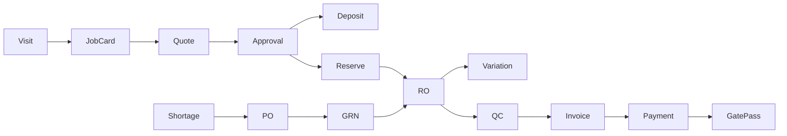

# GermanATO — Architecture (as implemented)

## Stack

| Layer | Tech | Path |
|-------|------|------|
| API | FastAPI, SQLAlchemy 2, JWT | `api/app/` |
| DB | PostgreSQL | `DATABASE_URL` |
| Web | React 19, Vite, TanStack Query | `web/` |
| Shared | Zod `@germanato/shared` | `shared/` |
| Migrations | Additive scripts | `api/migrate_foundation.py`, `api/migrate_pipeline.py` |

No Alembic. Integer PKs. Legacy money remains Float PKR; foundation helpers available for paisa.

## Runtime

- API: `uvicorn app.main:app --reload --host 127.0.0.1 --port 8000`
- Web: `npm run dev` → `http://localhost:5173` (proxies `/api`)
- Health: `GET /api/health`
- Seed admin: `python create_admin.py` → `admin` / `admin123`

## Workshop workflow

Guards live in `api/app/pipeline.py` (`next_action`, QC before invoice, payment gate on gate pass, invoice lock).

## Key modules

| Concern | Location |
|---------|----------|
| Foundation (branch, audit, soft delete, version, idempotency, settings, roles) | `api/app/foundation/` |
| Visits / check-in | `api/app/visits.py` |
| Job cards / quotes | `api/app/job_cards.py`, `routers/job_cards.py` |
| Line approval | `api/app/quote_approval.py`, `routers/public_quotes.py` |
| Parts reserve/issue/return | `api/app/parts_flow.py` |
| Deposits | `api/app/deposits.py` |
| Variations / QC / gate pass | `variations.py`, `qc.py`, `gate_pass.py` |
| PO receive / shortages | `api/app/po_receive.py`, vendor routes |
| Dashboard KPIs | `api/app/dashboard_kpis.py` |
| Money In/Out | `api/app/routers/money_facade.py` |

## Auth & permissions

- JWT access + refresh (`security.py`, `deps.py`)
- Roles: admin/owner, manager, accountant, service_advisor, technician, store_keeper (+ legacy aliases)
- Granular: `approve_discount`, `override_payment_gate`, `qc_signoff`, `adjust_stock`, `reopen_period`, `approve_evidence_exception`
- Nav gated by permission keys; sensitive writes use `require_override` / `require_permissions`

## Data integrity

- Soft delete via session hooks; lists exclude `deleted_at`
- Optimistic `version` → HTTP 409
- Idempotency-Key on creates (invoices, expenses, cash, POs, RO, job cards, deposits, QC, gate pass, PO receive)
- Advances = `CustomerDeposit` liability until applied to invoice
- PO receive updates stock + vendor ledger debit; partial qty supported

## Testing

- `api/tests/` — foundation, visits, ownership, pipeline, dashboard/PO/money (see suite)
- Web: `npm run build`, `npm run lint`

## Known limitations

- Offline sync not implemented
- Yearly financial close not formalized
- Money columns not migrated to paisa
- WhatsApp delivery requires Twilio env; otherwise log-only
- Secondary pages inherit tokens but are not all pixel-matched to mockups
- Payroll not included in Money Out total (documented in API note)
